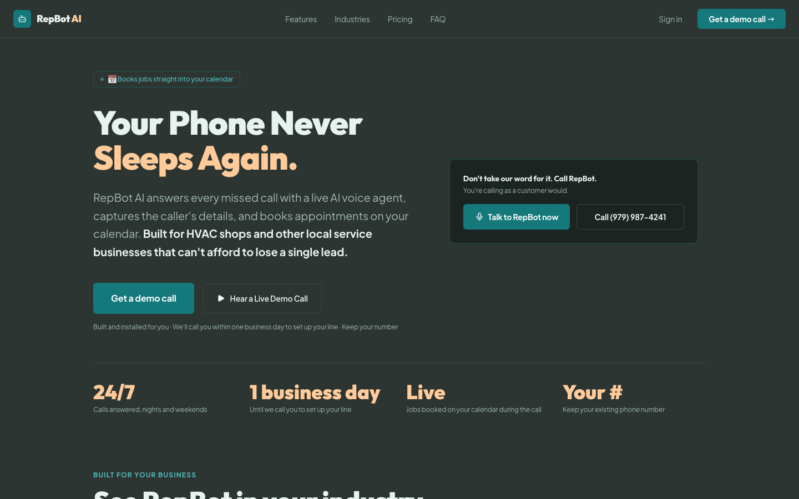

# RepBot: an AI receptionist for local service businesses

RepBot answers the calls an HVAC shop misses, takes the caller's details and books the job on the shop's calendar while the caller is still on the line. It's a live product I sell to Houston-area home service businesses at $149 a month with no setup fee.

This repository is a case study. The product code is private because it's a business I run, so this page covers how it's built and how I test it.

**Live site:** https://repbot.bartlettlabs.io
**Try it as a customer would:** call (979) 987-4241, or press "Talk to RepBot now" on the site.



## The problem

A plumber under a sink or an HVAC tech on a roof can't pick up the phone. The caller hangs up and dials the next shop in the search results. For a small shop, every missed call is a lost job, and an answering service costs more than most of them want to pay.

## How it works

```
Caller ──> phone number ──> Vapi voice agent ──> calendar tools ──> Google Calendar
                                    │
                                    └──> Postgres (calls, leads, transcripts) ──> owner dashboard
```

- **Voice agent.** A Vapi assistant per customer, with that shop's name, services, hours and service area. It handles emergencies (no heat, a gas smell, a water leak) as urgent, plus price shoppers, reschedules and out-of-scope calls.
- **Booking.** Calendar tools check open slots and write the appointment to the shop's Google Calendar during the call. When no slot is open, or the calendar API errors, the agent saves the lead and promises an office callback instead of making up a time.
- **Text-back.** A missed call can trigger an SMS follow-up through Twilio. Inbound texts are signature-checked, and STOP, START and HELP are handled. Sending stays switched off until the carrier approves the 10DLC registration.
- **Owner dashboard.** Next.js app with call transcripts, leads and per-customer usage. Usage that passes through to customers becomes monthly Stripe invoice drafts. Nothing sends or charges automatically.
- **ChatGPT connector.** A read-only MCP server with OAuth, so I can ask ChatGPT about my own pipeline, callbacks and recent calls.

## How I test it

A voice agent that books real appointments has to be tested on whole conversations, not on a handful of prompts. I built a synthetic caller harness:

1. **Dimensions first.** Four axes: caller intent (repair, three kinds of emergency, tune-up, price shopper, reschedule, out of scope, a prospect testing the demo), caller behavior (rushed, confused, evasive, chatty, "are you a robot?"), info quality (city-only address, a phone number with the wrong digit count, details that change mid-call, an address outside the service area) and tool condition (normal, no slots, tool error).
2. **20 hand-written combinations, then expansion.** I wrote the first 20 by hand, and a model expanded them to 100 caller personas.
3. **Run against the live assistant.** A model plays each persona in a text conversation with the live demo assistant through Vapi's Chat API, for up to 14 turns. The calendar tools point at mocks, so no-slot and error cases happen on demand and nothing real gets booked. The full 100-conversation run cost $5.50.
4. **Human review, pass or fail.** A review page shows each transcript next to its tool calls, with keyboard pass/fail labels and notes. No 1 to 5 scores. Those labels drive the error analysis that decides what to fix next.

## Stack

Next.js 16, React 19, TypeScript, Postgres, Vapi, Twilio, Google Calendar API, Stripe, MCP with OAuth 2.1. Self-hosted on a VPS with Coolify, behind Cloudflare.

## About

Built and run by [Kyle Bartlett](https://bartlettlabs.io) at Bartlett Labs.
